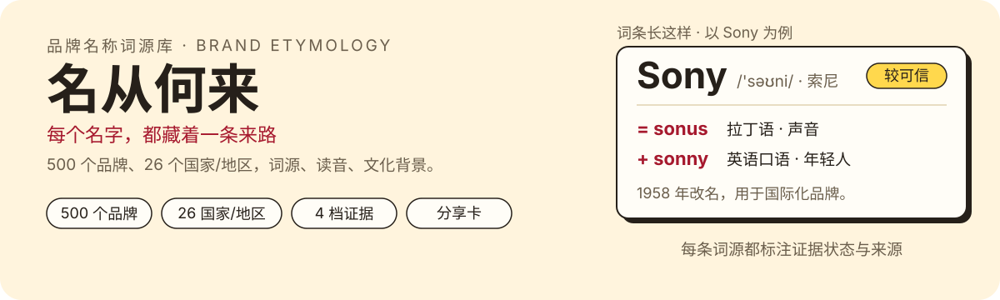
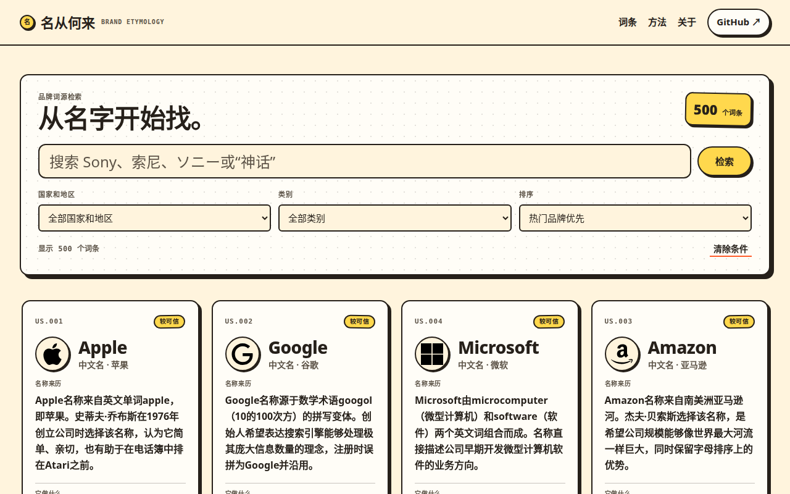
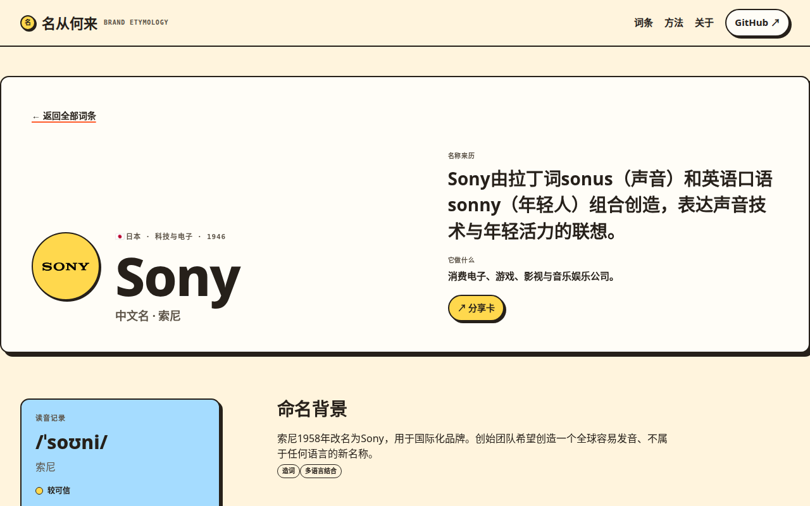

<p align="right"><a href="README.md">中文</a></p>

<p align="center">
  
</p>

<p align="center">
  <a href="https://xiaosang.cc/brand-etymology/">▶ Browse Online</a>
  ·
  <a href="https://holynova.github.io/brand-etymology/">GitHub Pages mirror</a>
  ·
  <a href="https://github.com/holynova/brand-etymology">GitHub Repository</a>
</p>

Brand Etymology (名从何来) is a library of brand-name origins: 500 brands across 26 countries/regions and 11 categories. Each entry explains where the name came from — etymology breakdown, IPA pronunciation, cultural background, naming method — with an evidence rating and cited sources. Search, filter by country/category, get similar-name recommendations, and generate a share card with a QR code for any entry.

## Screenshots

<p align="center">
  
</p>

<p align="center">
  
</p>

## What's in an Entry

- **Name origin**: the full etymology text, never truncated. Sony was coined from Latin *sonus* (sound) and English slang *sonny* (young fellow); Adidas combines founder Adolf "Adi" Dassler's nickname Adi with the first three letters of his surname, Das.
- **Pronunciation**: IPA transcription + a Chinese reading guide.
- **Naming background & lineage**: the backstory, root breakdown (language + meaning), and naming-method tags (e.g. "造词 coinage", "多语言结合 multilingual blend").
- **What it does**: a one-line brand blurb, founding year, and in-country rank.
- **Evidence rating**: four levels — 已确认 confirmed / 较可信 probable / 存在争议 disputed / 待考证 pending — always shown as a text sticker, never color alone.
- **Sources**: every entry lists its sources (five types: official, ranking, dictionary, archive, report); the method page (`/method/`) documents inclusion and verification standards.
- **Similar names**: detail pages recommend brands with similar naming approaches.

## Search & Share

- **Full-text search**: a Pagefind local index — search by English name, Chinese name, native name, or keyword (e.g. "神话" / mythology).
- **Filter & sort**: filter by country/region and category; sort by popularity or by country rank.
- **Share cards**: generate a vertical PNG from an entry card or detail page — brand name, full etymology, blurb, and a QR code to the archive.

## Data Sources

Etymology content comes from multi-source research and cross-checking: Wikidata, Wikipedia context, ChatGPT research, and Bing research; `scripts/` holds content validation (`validate-content.ts`), link checking (`check-links.ts`), and etymology audit (`audit-name-origins.ts`) scripts. 80 brand logos are SVG (Simple Icons / Iconify).

## Development

Node.js 22+:

```sh
npm install
npm run dev          # astro dev
npm run build:pages  # build to docs/ (GitHub Pages source) + Pagefind index
npm test             # content validation + Playwright site tests
```

## Tech

- Astro 7 static site + TypeScript; Pagefind full-text search; Baloo 2 display font; QRCode share cards.
- The visual language is sticker-on-paper (see `DESIGN.md`): warm paper `#fff4dd`, cocoa ink `#26201a`, madder red `#a6192e`, sunlight yellow `#ffd84d`, 2px ink borders + hard shadows with no blur.

```
src/pages/              Home / brand detail / country / category / method / about
src/data/brands.ts      Brand data (curated entries merged with the extended directory)
src/data/expanded-brands.ts   Extended brand directory by country/category
src/data/*.json         Wikidata / ChatGPT / Bing research data
src/lib/taxonomy.ts     26 countries, 11 categories, 4 confidence levels
src/lib/brand-presentation.ts   Entry presentation logic
src/components/         Brand logos / entry lists / share-card buttons
scripts/                Content validation / link checks / etymology research / logo generation
tests/site.spec.ts      Playwright site tests
docs/                   Build output (500 brand pages + index)
```
