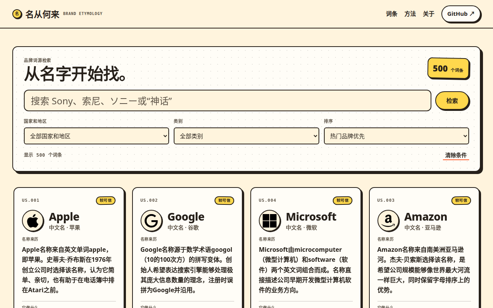
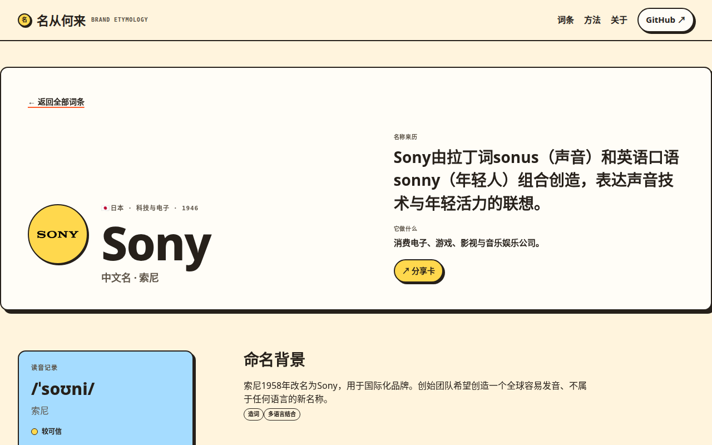

<p align="center">
  
</p>

<p align="center">
  <a href="https://xiaosang.cc/brand-etymology/">▶ 在线浏览 Browse Online</a>
  ·
  <a href="https://holynova.github.io/brand-etymology/">GitHub Pages 备选镜像</a>
  ·
  <a href="https://github.com/holynova/brand-etymology">GitHub 仓库</a>
</p>

名从何来是品牌名称词源库：500 个品牌、26 个国家/地区、11 个类别，每个词条讲清名字从哪来——词源拆解、读音（IPA）、文化背景、命名方法，并标注证据状态与来源。支持搜索、按国家/类别筛选、相似命名推荐，每条都能生成带二维码的分享卡。

Brand Etymology (名从何来) is a library of brand-name origins: 500 brands across 26 countries/regions and 11 categories. Each entry explains where the name came from — etymology breakdown, IPA pronunciation, cultural background, naming method — with an evidence rating and cited sources. Search, filter by country/category, get similar-name recommendations, and generate a share card with a QR code for any entry.

## 截图 / Screenshots

<p align="center">
  
</p>

<p align="center">
  
</p>

## 词条内容 / What's in an Entry

- **名称来历**：词源正文完整呈现，永不截断。如 Sony 由拉丁语 sonus（声音）与英语口语 sonny（年轻人）组合创造；Adidas 由创始人 Adolf “Adi” Dassler 的昵称 Adi 与姓氏前三字母 Das 拼成。
- **读音**：IPA 音标 + 中文读法。
- **命名背景与谱系**：背景故事、词根拆解（语言 + 含义）、命名方法标签（如"造词""多语言结合"）。
- **它做什么**：一句话品牌简介、成立年份、国家排名。
- **证据状态**：四档——已确认 / 较可信 / 存在争议 / 待考证，始终附文字贴纸，不只用颜色区分。
- **来源**：每条附来源列表（官网、榜单、词典、档案、报告五类），方法页（`/method/`）说明收录与考证口径。
- **相似命名**：详情页推荐命名方式相近的品牌。

## 检索与分享 / Search & Share

- **全文搜索**：Pagefind 本地索引，搜英文名、中文名、原文名或关键词（如"神话"）。
- **筛选排序**：按国家/地区、类别筛选；按热门品牌优先或国家榜单位次排序。
- **分享卡**：词条卡与详情页均可生成纵向 PNG，含品牌名、完整词源、简介与指向档案的二维码。

## 数据来源 / Data Sources

词源内容来自多路调研与交叉核对：Wikidata、维基百科上下文、ChatGPT 调研、Bing 调研；`scripts/` 下有内容校验（`validate-content.ts`）、链接检查（`check-links.ts`）、词源审计（`audit-name-origins.ts`）脚本。80 个品牌 logo 为 SVG（Simple Icons / Iconify）。

## 本地开发 / Development

Node.js 22+：

```sh
npm install
npm run dev          # astro dev
npm run build:pages  # 构建到 docs/（GitHub Pages 发布源）+ Pagefind 索引
npm test             # 内容校验 + Playwright 站点测试
```

## 技术 / Tech

- Astro 7 静态站 + TypeScript；Pagefind 全文搜索；Baloo 2 标题字体；QRCode 生成分享卡。
- 视觉是贴纸纸张语言（见 `DESIGN.md`）：暖纸 `#fff4dd`、可可墨 `#26201a`、茜色 `#a6192e`、日光黄 `#ffd84d`，2px 墨线边框 + 无模糊硬阴影。

```
src/pages/              首页 / 品牌详情 / 国家 / 类别 / 方法 / 关于
src/data/brands.ts      品牌数据（合并精编条目与扩展目录）
src/data/expanded-brands.ts   按国家/类别的扩展品牌目录
src/data/*.json         Wikidata / ChatGPT / Bing 调研数据
src/lib/taxonomy.ts     26 国家、11 类别、4 档可信度
src/lib/brand-presentation.ts   词条展示逻辑
src/components/         品牌 Logo / 词条列表 / 分享卡按钮
scripts/                内容校验 / 链接检查 / 词源调研 / Logo 生成
tests/site.spec.ts      Playwright 站点测试
docs/                   构建产物（500 个品牌页 + 索引）
```

## English

**Brand Etymology** (名从何来) answers a simple question for 500 brands: where did the name come from?

- **500 entries, 26 countries/regions, 11 categories** — each with the full etymology (never truncated), IPA pronunciation, cultural background, root breakdown (language + meaning), naming-method tags, founding year, and in-country rank.
- **Evidence, not just stories**: every entry carries a confidence rating — confirmed / probable / disputed / pending — plus cited sources (official, ranking, dictionary, archive, report). The method page (`/method/`) documents inclusion and verification standards.
- **Search & browse**: Pagefind full-text search over English, Chinese, and native names; filter by country/category; sort by popularity or country rank. Detail pages recommend similarly-named brands.
- **Share cards**: generate a vertical PNG for any entry — name, full etymology, blurb, and a QR code to the archive.
- **Data**: cross-checked from Wikidata, Wikipedia context, ChatGPT research, and Bing research, with validation, link-check, and audit scripts under `scripts/`.
- **Dev**: Node.js 22+, `npm run dev`, `npm run build:pages` (outputs to `docs/` + Pagefind index), `npm test` (content validation + Playwright).
- **Tech**: Astro 7 static site, TypeScript, Pagefind, Baloo 2 display font, QRCode share cards.
