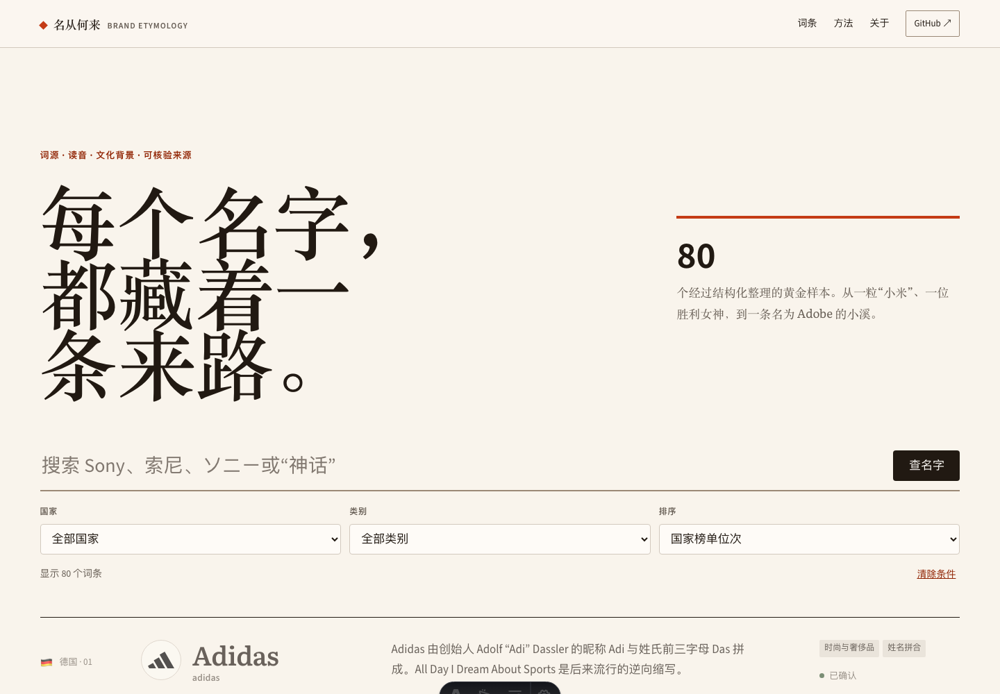

# 名从何来

用简洁故事解析品牌名的词源、读音与文化背景。收录 80 个中日韩、美英法意德品牌，支持搜索、分类、词源树、可信来源与相似命名。全站静态生成，无运行时 API。

[在线体验](https://holynova.github.io/brand-etymology/) · [GitHub 仓库](https://github.com/holynova/brand-etymology)
